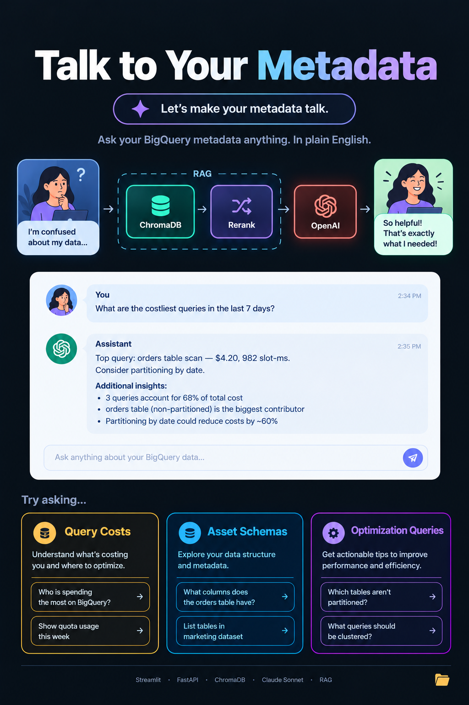
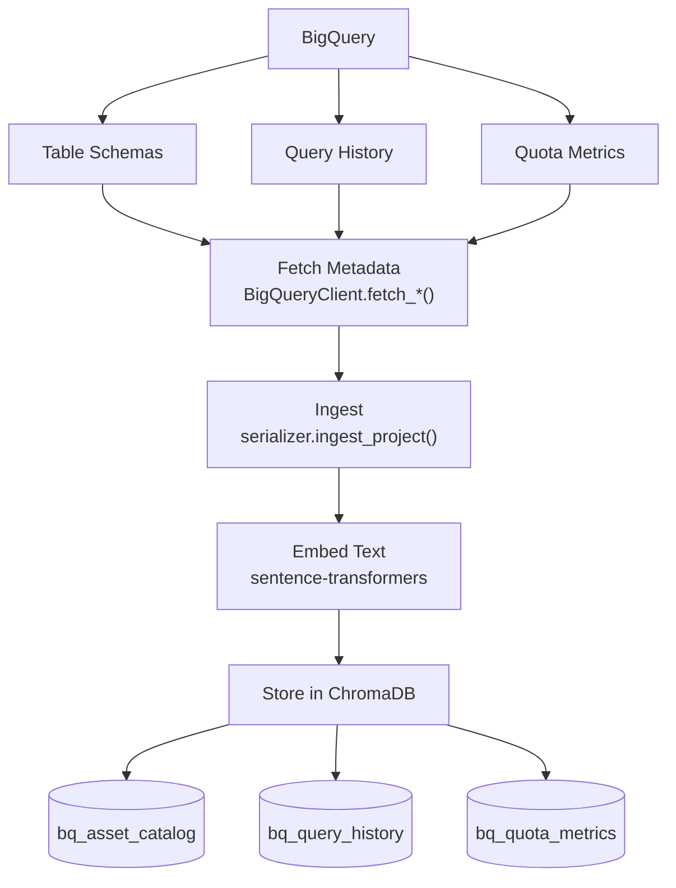
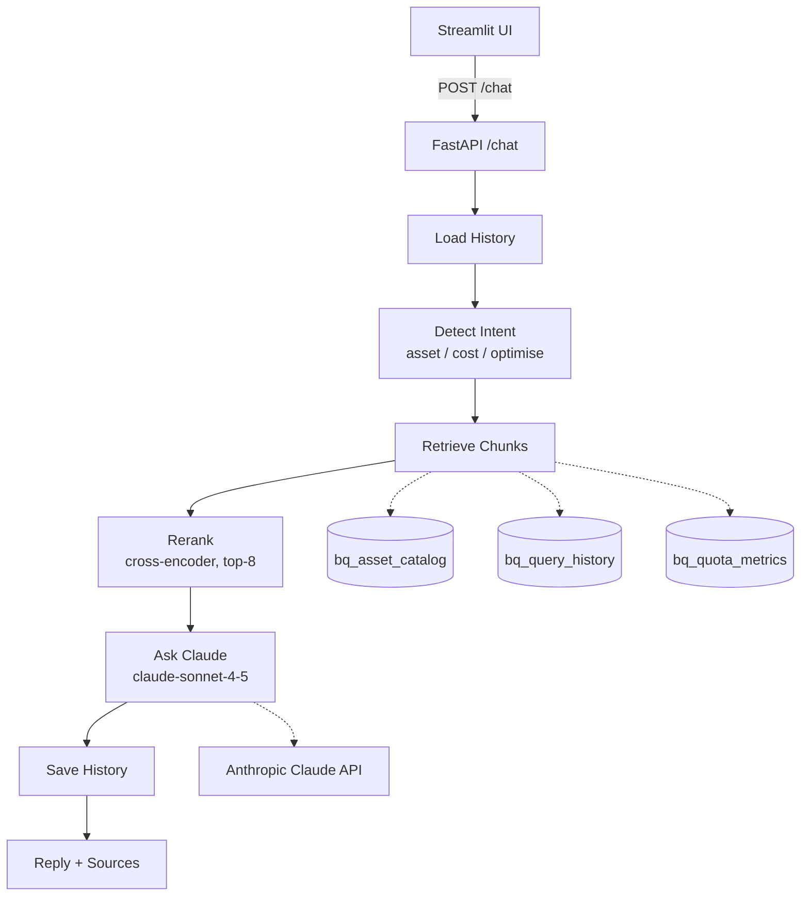

# Talk to Your Data - Hackday 45

[](https://buildkite.com/rea/ds-data-catalogue-hackday-45-talk-to-your-data)

A RAG-powered chatbot that lets anyone query BigQuery metadata — asset schemas, query costs, and optimisation opportunities — in plain English, without writing SQL.

---

## Poster



---

## Demos

| | |
|---|---|
| **Live demo** | [docs/ui/Live-demo-talk-to-your-data.MP4](docs/ui/Live-demo-talk-to-your-data.MP4) |
| **Figma Flow demo** | [docs/ui/flow-demo.MOV](docs/ui/flow-demo.MOV) |

---

## What is this?

Data teams spend a lot of time answering questions like:
- *"Which queries are costing us the most?"*
- *"Which tables are missing partitioning?"*
- *"What columns does the `listings` table have?"*
- *"What are the most expensive queries in the last 7 days by bytes billed?"*
- *"What are the most costly queries executed by me?"*
- *"What does the `usage_metrics` dataset contain?"*
- *"Who are the top users who spend the most in the `rea-gcp-dp-dev` project?"*

**Talk to Your Data** makes answering these as easy as typing a question. It works by:
1. **Ingesting** BigQuery metadata (table schemas, query history, quota metrics) into a local vector database (ChromaDB).
2. **Retrieving** the most relevant chunks for a user's question.
3. **Synthesising** a plain-English answer using Claude (Anthropic), with full conversation history for multi-turn follow-ups.

---

## Architecture

### Ingestion (run once, or on a schedule)

BigQuery metadata is scraped, embedded, and stored in ChromaDB across three collections:



Embeddings use `sentence-transformers` (`all-MiniLM-L6-v2`) — no external API needed for ingestion.


### Query (online — per user question)



**Design decisions:**

| Step | Reason |
|------|--------|
| Intent detection before retrieval | Targets only relevant Chroma collections, reducing noise |
| Rerank after retrieval | `optimise` queries 3 collections (~15 chunks); cross-encoder trims to top-8 before Claude |
| Single system prompt | Chunks carry `[collection_name]` labels — no specialised persona needed |
| History passed to Claude | Enables natural multi-turn conversation within a session |

---

## Retrieval details

### Intent -> collections

| Intent | Collections queried |
|--------|---------------------|
| `asset` | `bq_asset_catalog` |
| `cost` | `bq_query_history`, `bq_quota_metrics` |
| `optimise` | all three |

### Filters per collection

| Collection | Filters applied |
|------------|-----------------|
| `bq_asset_catalog` | `project_id`, `dataset_id` |
| `bq_query_history` | `project_id`, `user_email`, `creation_time >= cutoff` |
| `bq_quota_metrics` | none — all docs always retrieved |

`time_range` values: `last_1_day`, `last_7_days`, `last_30_days`, `last_90_days`, `all_time`.

---

## Quick start

```bash
# 1. Authenticate with GCP
gcloud auth application-default login

# 2. Ingest BigQuery metadata into ChromaDB (once)
./auto/run-local ingest --days 7

# 3. Start the Streamlit chat UI (requires Docker)
./auto/start-ui-app
# -> http://localhost:8501
```

For full setup instructions, credential configuration, and troubleshooting, see **[DEVELOPMENT.md](DEVELOPMENT.md)**.

---

## Python version

Requires Python 3.13+ (see [`pyproject.toml`](pyproject.toml)). Docker images build on Python 3.14.
Update [`pyproject.toml`](pyproject.toml), [`Dockerfile.vdb`](Dockerfile.vdb), and [`Dockerfile.ui`](Dockerfile.ui) if you need a different version.

